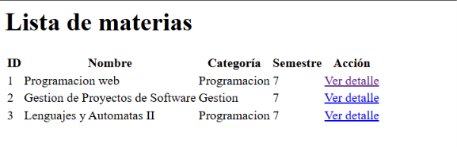
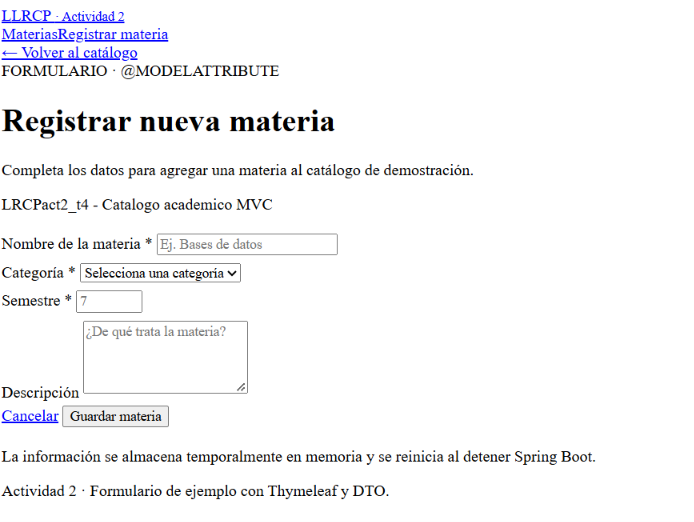
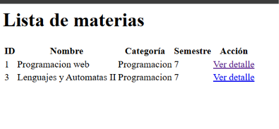
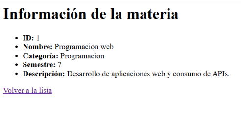
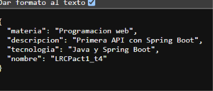
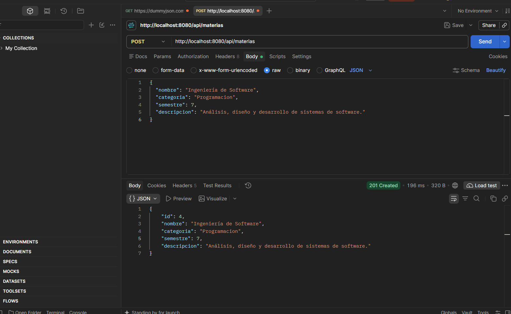
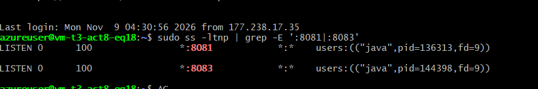

# Actividad 2 — Spring MVC, Thymeleaf, DTOs y Manejo de Peticiones

## Descripción

Esta aplicación amplía los conocimientos adquiridos en la Actividad 1 mediante la implementación del patrón MVC (Modelo-Vista-Controlador), utilizando Spring Boot y Thymeleaf para crear páginas HTML dinámicas.

Se desarrolló un catálogo académico de materias que permite visualizar registros, consultar detalles, filtrar por categoría y registrar nuevas materias mediante formularios HTML.

También se implementó un endpoint REST que permite enviar información en formato JSON desde Postman.

El proyecto fue desplegado en Microsoft Azure de manera independiente a la Actividad 1.

## Tecnologías utilizadas

- Java 21 (versión objetivo de compilación)
- Spring Boot 4.1.2
- Spring MVC
- Thymeleaf
- Maven
- HTML5
- CSS3
- JSON
- Postman
- Git y GitHub
- Microsoft Azure
- Ubuntu 24.04

## Estructura del proyecto

```text
lrcpact2-t4/
├── src/
│   └── main/
│       ├── java/
│       │   └── act_1t4/
│       │       ├── Lrcpact1T4Application.java
│       │       ├── controller/
│       │       │   ├── ProyectoController.java
│       │       │   ├── MateriasController.java
│       │       │   ├── MateriaMvcController.java
│       │       │   └── MateriaApiController.java
│       │       ├── dto/
│       │       │   └── MateriaDTO.java
│       │       └── service/
│       │           └── MateriaService.java
│       └── resources/
│           ├── templates/
│           │   ├── materias.html
│           │   ├── formulario.html
│           │   └── detalle.html
│           ├── static/
│           │   └── css/
│           │       └── estilos.css
│           └── application.properties
├── pom.xml
├── mvnw
├── mvnw.cmd
└── README.md
```

El proyecto conserva algunos nombres de clases y paquetes de la Actividad 1 como peticion de la actividad.

## Patrón MVC

La aplicación implementa el patrón Modelo-Vista-Controlador para separar las responsabilidades.

### Modelo

Se implementó la clase `MateriaDTO`, utilizada para representar y transportar información de las materias.

El servicio `MateriaService` concentra las operaciones relacionadas con la consulta y registro de materias.

### Vista

Las interfaces se construyeron con Thymeleaf y HTML.

Se desarrollaron tres plantillas:

- `materias.html`: presenta el listado de materias.
- `formulario.html`: permite registrar nuevas materias.
- `detalle.html`: muestra la información individual de una materia.

### Controlador

`MateriaMvcController` recibe las peticiones HTTP, solicita la información correspondiente al servicio y la envía a las vistas mediante el objeto `Model`.

También se implementó `MateriaApiController` para recibir información JSON mediante peticiones REST.

## Funcionalidades

### 1. Listado dinámico de materias

La aplicación muestra un catálogo de materias utilizando Thymeleaf.

La instrucción `th:each` permite recorrer los elementos recibidos desde el controlador y generar una fila HTML por cada materia.

**Endpoint:**
http://65.52.8.72:8083/mvc/materias



`GET /mvc/materias`

### 2. Formulario de registro

Se desarrolló un formulario HTML que permite capturar la información de una nueva materia.

El formulario utiliza `@ModelAttribute` para asociar automáticamente los datos enviados con un objeto `MateriaDTO`.

**Endpoints:**
http://65.52.8.72:8083/mvc/materias/nuevo



- `GET /mvc/materias/nuevo`
- `POST /mvc/materias/guardar`

### 3. Filtrado por categoría

Se implementó `@RequestParam` para recibir un parámetro de consulta desde la URL y filtrar las materias.

**Endpoints:**
http://65.52.8.72:8083/mvc/materias?categoria=Programacion



### 4. Consulta de detalles

Se utilizó `@PathVariable` para recuperar el identificador de una materia desde la URL.

**Endpoints:**
http://65.52.8.72:8083/mvc/materias/1




### 5. Registro mediante API REST

Se implementó un controlador REST con `@RequestBody` para recibir información JSON enviada desde Postman.

**Endpoint:**
http://65.52.8.72:8081/proyecto




## Endpoints del proyecto

| Método | Ruta | Descripción |
|---|---|---|
| GET | `/mvc/materias` | Listar materias |
| GET | `/mvc/materias/nuevo` | Mostrar formulario |
| POST | `/mvc/materias/guardar` | Registrar materia desde HTML |
| GET | `/mvc/materias?categoria=Programacion` | Filtrar materias |
| GET | `/mvc/materias/{id}` | Consultar detalle |
| POST | `/api/materias` | Registrar materia mediante JSON |

Además, el proyecto conserva los endpoints REST originales de la Actividad 1.


## Persistencia de datos

Para esta actividad se utilizó almacenamiento temporal en memoria mediante una colección de Java.

Esto permite registrar y consultar materias durante la ejecución de la aplicación, pero los registros agregados no se conservan después de reiniciar Spring Boot.

La implementación de persistencia con una base de datos real corresponde a la Actividad 3.

## Ejecución local

Dentro de la carpeta principal del proyecto, ejecutar:

```bash
./mvnw.cmd spring-boot:run
```

La aplicación se inicia localmente en el puerto 8080.

Abrir:

http://localhost:8080/mvc/materias

Formulario:

http://localhost:8080/mvc/materias/nuevo

Filtro:

http://localhost:8080/mvc/materias?categoria=Programacion

Detalle:

http://localhost:8080/mvc/materias/1


### Enlaces

http://65.52.8.72:8083/mvc/materias

**Actividad 1 funcionando en su puerto original:**

http://65.52.8.72:8081/proyecto


### Petición JSON con Postman



### Despliegue en Azure




## Autor

**León Ramírez Carlos Pavel**

Ingeniería en Sistemas Computacionales

Materia: Programación Web

Actividad 2 — Spring MVC, Vistas con Thymeleaf, DTOs y Manejo de Peticiones